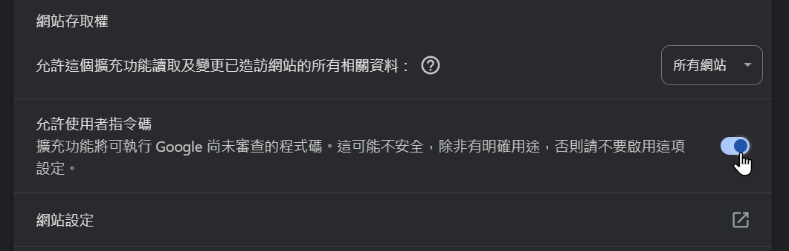

# Tampermonkey Userscripts

> 看到哪個網站用起來卡卡的，就寫一支小腳本把它改順。這裡是 [Will 保哥](https://www.facebook.com/will.fans/) 多年來累積的 [Tampermonkey](https://www.tampermonkey.net/) 使用者腳本（Userscript）合集，全部依「**應用場景**」分類，方便你直接找到現在想解決的那個問題。

**74 個腳本** · **8 個應用場景** · 短網址：[tm.miniasp.com](https://tm.miniasp.com) · 授權：[MIT](LICENSE)

---

## 🧭 快速跳轉

點分類直接跳到該區塊，找到腳本後點左側的安裝圖示即可。

| | 分類 | 什麼時候會用到 | 腳本數 |
| :-: | :--- | :--- | ---: |
| 🤖 | [AI 工具增強](#ai-tools) | 每天在用 ChatGPT / Gemini / Claude / Felo / Coze 工作 | 19 |
| 📖 | [中文閱讀、翻譯與排版](#chinese-reading) | 想簡轉繁、中英之間補空格、或只看文章主體 | 8 |
| 📄 | [內容擷取、Markdown 與網頁快照](#capture) | 把網頁變成 Markdown，或整頁快照發佈成公開連結 | 6 |
| ☁️ | [Azure 與 GCP](#cloud) | 每天在 Azure DevOps、Azure Portal、GCP Console 上幹活 | 12 |
| 🛠️ | [開發者工具與 GitHub 增強](#dev-tools) | 檢查連結、清掉追蹤碼、匯出 localStorage、強化 GitHub | 11 |
| 💬 | [社群與影音](#social) | Facebook、Bluesky、YouTube 的日常使用與內容處理 | 7 |
| 🏦 | [企業系統與表單](#enterprise) | 銀行網站登入、PDF-XChange、Microsoft Forms、Power Automate | 5 |
| 🧹 | [去廣告與介面淨化](#cleanup) | 蓋版廣告、漂浮廣告、付費牆、擋在畫面上的無用提示 | 6 |

> 🔧 第一次使用？先看 [安裝 Tampermonkey](#install)，那是**只需要做一次**的設定。

---

## 🤖 AI 工具增強

把 ChatGPT、Gemini、Claude 這些 AI 服務的常見操作（翻譯、總結、語音、複製提示）變成右鍵或一個快速鍵就能完成。

**ChatGPT**

| 安裝 | 腳本 | 用途 |
| :-: | :--- | :--- |
|  | [ChatGPT](https://chatgpt.com/): 好用的鍵盤快速鍵集合 | `Ctrl+Delete` 刪除當前對話、`Ctrl+B` 切換側邊欄 |
|  | [ChatGPT](https://chatgpt.com/): 語音輸入與語音合成（中／英／日／韓） | 用講的問問題，也讓回答自動朗讀出來；支援語音命令與多語切換 |
|  | [ChatGPT](https://chatgpt.com/): 在回應結果旁加入常見提示按鈕 | 一鍵追問「繼續」「翻譯成中文」這類常用提示，自動填入並送出 |
|  | [ChatGPT](https://chatgpt.com/): 滑鼠雙擊編輯提示文字 | 雙擊先前送出的提示，直接就地把文字改掉 |
|  | [ChatGPT](https://chatgpt.com/): 自動填入提示文字並自動送出 | 開好頁面就幫你填好提示，可設定要不要自動送出 |
|  | [ChatGPT](https://chatgpt.com/): 統計選取範圍的 Token 數量 | 選取文字就即時算出 Token 數（OpenAI GPT-3 Tokenizer 規則） |
|  | [ChatGPT](https://chatgpt.com/): 自動總結文章內容 | 把選取範圍（或頁面第一個 `<article>`）送到 ChatGPT 總結 |
|  | [ChatGPT](https://chatgpt.com/): 翻譯選取文字（中翻英） | 選取中文後送出，直接請 ChatGPT 翻成英文 |
|  | [ChatGPT](https://chatgpt.com/): 翻譯選取文字（英翻中） | 選取英文後送出，直接請 ChatGPT 翻成中文 |
|  | [ChatGPT](https://chatgpt.com/): 開啟常用參考連結 | 把常用的 ChatGPT 相關連結集中成一個入口 |

<b>ChatGPT 語音輸入：快速鍵與語音命令</b>

| 快速鍵 | 功能 |
| :--- | :--- |
| `alt+s`（Mac：`command+option+s`） | 啟動／停止語音辨識 |
| `alt+m`（Mac：`command+option+m`） | 啟動／停止朗讀 |
| `alt+t`（Mac：`command+option+t`） | 立刻停止語音辨識與語音合成 |
| `alt+r` / `Escape` | 重設語音辨識狀態 |

- 在麥克風圖示上按**滑鼠右鍵**可切換辨識語言（中／英／日／韓）；在喇叭圖示上按右鍵可切換朗讀聲音來源。
- 支援語音命令：送出、清除、刪除、換行、重置、貼上、解釋以下程式碼、重新整理、切換至英文／日文／韓文／中文模式、關閉語音辨識。
- 影片教學：[Part 1](https://www.youtube.com/watch?v=DgFwtRj4jkU)、[Part 2](https://www.youtube.com/watch?v=bMsh_Vw9SNc)（內容較舊，操作概念仍適用）

**Gemini**

| 安裝 | 腳本 | 用途 |
| :-: | :--- | :--- |
|  | [Gemini](https://gemini.google.com/): 翻譯選取文字（中翻英） | 右鍵把目前選取範圍送到 Gemini 翻成英文 |
|  | [Gemini](https://gemini.google.com/): 翻譯選取文字（英翻中） | 右鍵把目前選取範圍送到 Gemini 翻成中文 |
|  | [Gemini](https://gemini.google.com/): 總結選取文字 | 右鍵把選取範圍送到 Gemini 做摘要 |
|  | [Gemini](https://gemini.google.com/): 切換語音輸入 | `alt+t` 開關 Gemini 的語音輸入模式 |
|  | [Gemini](https://gemini.google.com/app) 🍌 無「印」良品 | 自動辨識並移除 Nano Banana Pro 生成圖片的浮水印 |

**其他 AI 服務**

| 安裝 | 腳本 | 用途 |
| :-: | :--- | :--- |
|  | [Felo Search](https://felo.ai/): 鍵盤快速鍵集合 | `Ctrl+B` 側邊欄、`Ctrl+Delete` 刪除對話、`j` / `k` 切換歷史紀錄 |
|  | [Coze](https://www.coze.com/): 快速鍵增強 | `h` 首頁、`p` Personal、`s` 訂閱、`t` 切換 Teams、`alt+p` 個人檔案、`alt+1`~`5` 切換 Space 頁籤 |
|  | [OpenAI Platform](https://platform.openai.com/): 鍵盤快速鍵集合 | `Ctrl+B`（或 `f`）切換文件頁面的側邊欄 |
|  | [Google AI Studio](https://aistudio.google.com/): 強制淺色主題 | 不論系統設定，一律用淺色主題，簡報與截圖時畫面更清楚 |

<a href="#nav">⬆️ 回到快速跳轉</a>

---

## 📖 中文閱讀、翻譯與排版

簡繁轉換、中英之間補空格、標點校正，以及「只看文章主體」的專注閱讀模式。

| 安裝 | 腳本 | 用途 |
| :-: | :--- | :--- |
|  | 多奇中文簡繁轉換大師 | 自動偵測簡體頁面並轉成繁體，同時把中國大陸用語換成台灣說法（含頁面標題與屬性值）；支援 SPA，連按 `stt` 可再次轉換 |
|  | 為什麼你們就是不能加個空格呢？ | 自動在中文與英文、數字、符號之間補上空格，看得比較不痛苦 |
|  | [Claude](https://claude.ai/): 自動校正標點符號 | 修正 Claude 聊天介面上的全形／半形標點，並補上中英之間的空格 |
|  | 中、英文網頁切換器 | `alt+s` 在目前網頁的中文版與英文版之間切換 |
|  | 沉浸式翻譯: 修正翻譯後樣式跑掉的問題 | 把譯文中殘留的 `**` 粗體與反引號行內程式碼標記，換成正確的 HTML 樣式 |
|  | ReadingMode: 讓網頁更容易閱讀與翻譯 | `Alt+Ctrl+Shift+F`（Mac：`Cmd+Option+Shift+F`）只留 `<main>` 內容，`Esc` 還原 |
|  | [Microsoft Learn](https://learn.microsoft.com/): 鍵盤快速鍵集合 | `f` 隱藏非主要內容的區塊，留下乾淨的閱讀畫面 |
|  | [GitHub Docs](https://docs.github.com/): 鍵盤快速鍵集合 | `f` 隱藏非主要內容的區塊，方便閱讀與翻譯 |

<a href="#nav">⬆️ 回到快速跳轉</a>

---

## 📄 內容擷取、Markdown 與網頁快照

把網頁內容變成 Markdown 丟進剪貼簿，或把整個頁面狀態打包成一個公開網址分享出去。

| 安裝 | 腳本 | 用途 |
| :-: | :--- | :--- |
|  | 在網頁複製內容時，自動寫入 `text/markdown` | 平常的 `Ctrl+C` 照用，但剪貼簿同時多了選取範圍的 Markdown 版本，貼到筆記軟體就會是排版好的格式 |
|  | 將網頁內容轉成 Markdown 並寫入剪貼簿 | 選取範圍後按滑鼠右鍵，把該段 HTML 轉成 Markdown 複製起來 |
|  | [Jina Reader](https://jina.ai/reader/): 把現有網頁轉成 Markdown | `alt+r` 把目前頁面導向 Jina Reader，直接取得 Markdown 版本 |
|  | 網頁狀態與任意內容發佈到 Infinitybin | 把目前網頁狀態（或任意貼上的文字）打包成單一 HTML 發佈到 Azure Blob，取得可直接分享的公開網址 |
|  | 網頁快照發佈（重播模式・右鍵快速執行） | 右鍵直接以「重播模式」發佈，省略開 Tampermonkey 選單的步驟 |
|  | 網頁快照發佈（靜態快照・右鍵快速執行） | 右鍵直接以「靜態快照」發佈，凍結當下畫面並移除腳本 |

<b>網頁快照：重播模式與靜態快照要選哪一個？</b>

**重播模式**（`SavePageToAzureBlob` 選單的「📸 發佈到 Infinitybin（重播模式）」）

- 重新取得尚未執行腳本的原始 HTML 並保留頁面腳本，快照開啟時自己渲染一次。
- 站內搜尋、頁籤切換等互動在發佈後仍然可用，也不會出現「同一組介面重複兩次」。
- 限制：需要能重新取得原始 HTML；內容完全由前端 API 產生的頁面（SPA 空殼）會自動降級為靜態快照並在狀態列說明原因；`<script type="module">` 只保留絕對網址載入。

**靜態快照**（`SavePageToAzureBlob` 選單的「🖼️ 發佈到 Infinitybin（靜態快照）」）

- 凍結目前看到的畫面並移除所有腳本，畫面保證與發佈當下一模一樣。
- 代價是依賴 JS 的互動（站內搜尋、頁籤切換）會失效；內容由前端 API 產生的頁面請用這一個。

另外還有「📋 將任意內容發佈到 Infinitybin」，可貼上文字並依內容自動推測 HTML／Markdown／CSV／JSON 後發佈。瀏覽已發佈的頁面時，頁面底部會出現刪除工具列。

> 需要先以 Container SAS URL（`sp=cw`，要刪除頁面則需 `sp=cwd`）完成設定；發佈本機 `file://` 頁面時，需開啟 Tampermonkey 的「允許存取檔案網址」與「允許腳本存取本機檔案」。

<a href="#nav">⬆️ 回到快速跳轉</a>

---

## ☁️ Azure 與 GCP

雲端控制台每天都要開，所以能省一次點擊或一次找按鈕的時間都值得。

**Azure DevOps**

| 安裝 | 腳本 | 用途 |
| :-: | :--- | :--- |
|  | [Azure DevOps](https://dev.azure.com/): 優化快速鍵操作 | 讓快速鍵貼近 VS Code 與 Vim：`go` 開頭跳頁、`j` / `k` 移動列表、`c` 建立 PR |
|  | [Azure DevOps](https://dev.azure.com/): 啟用鍵盤快速鍵 | 讓官方的鍵盤快速鍵一直保持可用，不會莫名其妙失效 |
|  | [Azure DevOps](https://dev.azure.com/): 佈景主題切換器 | `alt+s` 切換 Dark／Light 模式 |
|  | [Azure DevOps](https://dev.azure.com/): 完整預覽 Repos 中的檔案 | 在檔案頁籤列加上「完整預覽」，HTML 可在 sandbox iframe 中跑 JS；Markdown、PDF、Excel、Word、PowerPoint 也各有專屬預覽 |
|  | [Azure DevOps](https://dev.azure.com/): 調整頁面標題 | 讓 Work Item 的頁面標題帶上真正有用的資訊（專案、ID、標題） |
|  | [Azure DevOps](https://dev.azure.com/): 調整 Pipeline Log 顯示寬度 | `+` / `-` 放大縮小左欄，也可以直接拖曳分隔線 |
|  | [Azure DevOps](https://dev.azure.com/): 工作項目直接播放螢幕錄影 | 把 Work Item 裡的 Screen recording 連結改成可直接播放的影片 |
|  | [Azure DevOps](https://dev.azure.com/): Wiki TOC 改為浮動側邊資訊卡 | 把 `[[_TOC_]]` 變成右側深／淺色浮動目錄卡，可切換主題並記住偏好 |
|  | [Azure DevOps](https://dev.azure.com/): 調整 Wiki TOC 標題寬度 | 讓 Wiki 目錄的標題完整顯示，不再被截斷 |

<b>Azure DevOps 快速鍵一覽</b>

**全站**

- `Alt+1` ~ `Alt+3`：切換頁籤
- `j` / `k`：在列表項目往下／往上移動選取（按 `Enter` 進入）

**首頁**

- `1` ~ `4`：快速進入首頁前幾張卡片
- `j` / `k`：移動專案清單選取；`h` / `l`：在專案項目的左右連結間移動（按 `Enter` 進入）
- `f`：跳到 Filter projects（`Escape` 離開）；`s`：跳到搜尋整個組織（`Escape` 離開）

**專案內所有頁面**

- `Ctrl+B`：切換側邊欄
- `go` / `gw` / `gd`：Overview 的 Summary／Wiki／Dashboards
- `gl` / `gs`：Boards 的 Backlogs／Sprints
- `gb` / `gr`：Pipelines 的 Builds／Releases

**Overview > Wiki**

- `j` / `k`：移動左側目錄選取（按 `Enter` 進入）
- `f`：跳到 Filter pages by title（`Enter` 回到 j/k 模式，`Escape` 離開）
- `Space` / `Shift+Space`：文章往下／往上捲動

**Repos > Pull requests**

- `c`：畫面上出現 Create a pull request 按鈕時，按 `c` 直接點下去

**Azure Portal**

| 安裝 | 腳本 | 用途 |
| :-: | :--- | :--- |
|  | [Azure Portal](https://portal.azure.com/): 敏感資料隱碼處理 | 把畫面上可能的敏感資訊模糊掉，錄影、分享螢幕或截圖時不怕外洩 |
|  | [Azure Portal](https://portal.azure.com/): 移除所有 `...` 樣式 | 拿掉截斷用的刪節號，看帳單時數字不會再被省略成 `...` |

**Google Cloud Platform**

| 安裝 | 腳本 | 用途 |
| :-: | :--- | :--- |
|  | [GCP Console](https://console.cloud.google.com/): 鍵盤快速鍵集合 | Billing 清單按 `1`~`9` 直接開第 N 個帳單帳戶；`gb` Billing、`gh` 首頁、`gp` Manage resources、`gc` Credits／Credentials |

<a href="#nav">⬆️ 回到快速跳轉</a>

---

## 🛠️ 開發者工具與 GitHub 增強

檢查連結、清掉追蹤碼、把 localStorage 搬來搬去，順手把 GitHub 的介面補強一下。

**GitHub**

| 安裝 | 腳本 | 用途 |
| :-: | :--- | :--- |
|  | [GitHub](https://github.com/): Top Bar Actions | 頂部工具列加入主題切換、用量查看與 Fine-grained PAT 快速建立按鈕（`Alt+T` / `Alt+P`） |
|  | [GitHub](https://github.com/): 提升使用者體驗的小工具 | 在 Repositories 分頁自動聚焦篩選框，單頁導覽後也會重新回焦 |
|  | [GitHub](https://github.com/): 新增 DeepWiki 按鈕 | Repo 右上按鈕列多一個 DeepWiki，一鍵打開對應的 AI 文件（例如 `https://deepwiki.com/anthropics/skills`） |

**跨網站工具**

| 安裝 | 腳本 | 用途 |
| :-: | :--- | :--- |
|  | 網頁連結檢查器 | 手動檢查頁面上所有可見的圖片、超連結、影片與音訊網址，可只檢查外部連結，並以不同顏色框線標示結果 |
|  | 網站追蹤碼移除工具 | 移除大多數網站附加在超連結上的 Query String 追蹤碼，複製出去的網址乾淨多了 |
|  | 按下多次 Ctrl-C 就會自動複製網址 | `learn.microsoft.com` 連按兩次 `Ctrl-C` 會移除 `view` 參數；GitHub 連按兩次複製 Repo 網址、三次複製 `git clone` 指令（在分支或 PR 頁面會自動帶入對應內容） |
|  | 偵錯工具: localStorage 複製／貼上 | 透過選單命令匯出／匯入目前網站的 localStorage，方便在不同電腦之間交換除錯狀態 |
|  | 表單快照與人類模擬回填 | 儲存目前頁面的表單快照，之後用「像人在填」的節奏回填，支援 JSON 匯出／匯入跨電腦移轉 |
|  | 防止意外關閉頁籤 | 在 `github.dev`、Kudu（`scm.azurewebsites.net/dev`）、Google Meet 上避免誤按 `Ctrl+W` 把整個工作階段關掉 |
|  | Blur Keywords | 把頁面上的敏感關鍵字模糊處理，錄影、簡報或截圖前先蓋一層 |
|  | MVP: Microsoft Docs & Learn Champion Program | 在符合的網址自動加上 `WT.mc_id=DT-MVP-4015686` 追蹤碼 |

<a href="#nav">⬆️ 回到快速跳轉</a>

---

## 💬 社群與影音

Facebook、Bluesky、YouTube 的日常使用體驗，以及影片字幕的取得與翻譯。

| 安裝 | 腳本 | 用途 |
| :-: | :--- | :--- |
|  | Facebook: 鍵盤快速鍵集合 | `f` 切換側邊欄、`Ctrl+I` 檢舉留言、`Ctrl+Delete` 刪除留言、`Alt+B` 封鎖洗版帳號 |
|  | Facebook: FixWarnLink | 點站外連結時不用再按一次「確定要離開」的確認按鈕 |
|  | Facebook: PunycodeConverter | 把貼文裡被編碼成 Punycode 的網址還原成正常的 Unicode 文字 |
|  | Facebook: 移除「商店」按鈕 | 移除畫面上方的商店頁籤，少一個誤點廣告的地方 |
|  | [Bluesky](https://bsky.app/): 鍵盤快速鍵集合 | `g` 接著按 `h`：優先在頁面上找 Profile 連結，找不到才開啟 doggy8088 的個人頁 |
|  | [YouTube](https://www.youtube.com/): 自動下載影片字幕 | `alt+s` 或點播放器旁的按鈕，自動到 downsub 下載目前影片的 RAW 字幕 |
|  | [YouTube](https://www.youtube.com/): Gemini 即時字幕翻譯 | 攔截英文字幕並用 Gemini 即時翻成繁體中文，翻譯時自動帶入影片標題、描述與前 20 句字幕作為上下文 |

<a href="#nav">⬆️ 回到快速跳轉</a>

---

## 🏦 企業系統與表單

銀行網站、企業內的表單與管理後台——這些地方無法改，但可以在瀏覽器這一側補起來。

| 安裝 | 腳本 | 用途 |
| :-: | :--- | :--- |
|  | [SinoBank](https://mma.sinopac.com): 永豐銀行 MMA 登入啟用密碼管理器 | 讓 [MMA 金融交易網](https://mma.sinopac.com/MemberPortal/Member/NextWebLogin.aspx) 的登入頁可以正常使用密碼管理器（LastPass、1Password、Dashlane、Bitwarden…） |
|  | 玉山銀行: 添加遺失的表單欄位 `id` 屬性 | 補上[玉山全球智匯網](https://gib.esunbank.com/)登入頁缺少的 `id`，修好密碼管理器無法自動填入的問題 |
|  | PDF-XChange: `Ctrl+V` 自動貼上建立客戶的欄位 | 先複製客戶資料的 JSON，按 `Ctrl+V` 就把建立客戶頁面的欄位一次填完 |
|  | Microsoft Forms: 讓選項顯示更寬 | 在回應頁按 `+` 調寬、按 `-` 調窄，長選項終於不用硬猜 |
|  | Power Automate: 調整顯示名稱欄位寬度 | 把 Flows 的 Name 欄位加寬到 750px，標題可以完整顯示 |

<a href="#nav">⬆️ 回到快速跳轉</a>

---

## 🧹 去廣告與介面淨化

蓋版廣告、漂浮廣告、付費牆、擋在畫面上的提示列——把它們請走，畫面還給內容。

| 安裝 | 腳本 | 用途 |
| :-: | :--- | :--- |
|  | [104](https://vip.104.com.tw/): 自動隱藏智能客服浮動選單 | 自動偵測並移除 104 VIP 站的浮動客服選單（有處理 SPA 換頁） |
|  | [Accupass](https://www.accupass.com/): 刪除活動頁面的漂浮廣告 | 刪掉活動頁上一直跟著你飄的廣告 |
|  | 博客來: 刪除首頁的蓋版廣告 | 刪掉博客來首頁的蓋版廣告 |
|  | [Medium](https://medium.com/): 刪除要求註冊的蓋版廣告 | 移除要求註冊的覆蓋層，文章不會再被遮住 |
|  | NYTimes: 移除付款提示畫面 | 看 [New York Times](https://www.nytimes.com/) 新聞時移除擋在文章上的訂閱提示 |
|  | [Google Apps Script](https://script.google.com/): 隱藏警告列 | 自動隱藏執行頁面上的警告提示列 |

<a href="#nav">⬆️ 回到快速跳轉</a>

---

## 🔧 安裝 Tampermonkey（只需要做一次）

設定一次就好，之後看到想用的腳本，點一下安裝圖示、按 **Install** 就完成了。

### 1. 先裝瀏覽器擴充套件

<table border="0">
<tr>
  <td>
    
  </td>
  <td>
    
  </td>
  <td>
    
  </td>
  <td>
    
  </td>
</tr>
<tr>
  <td align="center">Google Chrome</td>
  <td align="center">Microsoft Edge</td>
  <td align="center">Mozilla Firefox</td>
  <td align="center">Apple Safari</td>
</tr>
</table>

### 2. 開啟瀏覽器的「開發人員模式」

到[管理擴充功能](chrome://extensions/)頁面，啟用「**開發人員模式**」選項。
（Chrome 與 Edge 都需要這一步，否則 Tampermonkey 無法執行使用者腳本。）

### 3. 在 Tampermonkey 啟用「允許使用者指令碼」

到**篡改猴**的**擴充功能管理頁面**，把「**允許使用者指令碼**」打開：

### 4. 點安裝圖示，按下 Install

回到上面的分類，點腳本左側的**安裝圖示**，就會開啟 Tampermonkey 的安裝頁面，按下 **Install** 即完成：

> **小提醒**
>
> - 腳本會隨著網站改版而更新，遇到功能突然怪怪的，先到 Tampermonkey 的「檢查更新」看看有沒有新版。
> - 若某個網站完全沒反應，通常是 `@match` 沒涵蓋到你用的網域（例如 `chat.openai.com` 與 `chatgpt.com` 的差別），或第 2、3 步沒開。

---

## 🔗 相關連結

- [Tampermonkey • Documentation](https://www.tampermonkey.net/documentation.php)
  - [@run-at](https://www.tampermonkey.net/documentation.php#_run_at)
- [Will 保哥的技術交流中心](https://blog.miniasp.com/)
- [本專案的 GitHub Issues](https://github.com/doggy8088/TampermonkeyUserscripts/issues) — 有問題或想許願都在這裡

<a href="#top">⬆️ 回到頂端</a>

